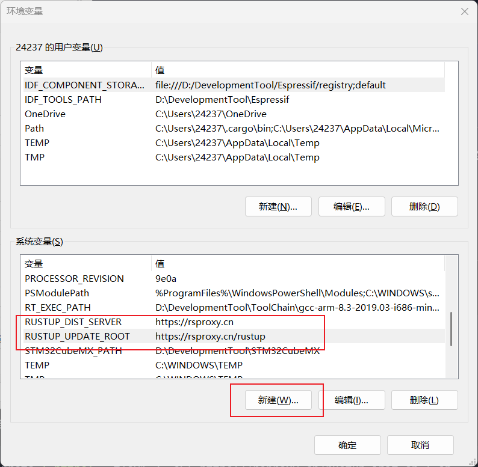

# 环境搭建

[安装RUST](https://rustup.rs)

```bash
rustup target add thumbv7em-none-eabihf # 添加target STM32F4/F7/H7 → Cortex-M4/M7 (有FPU)
```

[Arm GNU Toolchain 下载](https://developer.arm.com/downloads/-/arm-gnu-toolchain-downloads)

```
arm-none-eabi-ld --version # 检查arm gun toolchain版本
```

```bash
# 选择宿主 Rust 工具链
rustup toolchain install stable-x86_64-pc-windows-gnu
rustup default stable-x86_64-pc-windows-gnu
```

```bash
# 创建裸机项目
cargo install cargo-generate
cargo generate --git https://github.com/rust-embedded/cortex-m-quickstart
```

# RUST代理设置



# 常用命令

## rustup

```bash
rustup target list # 列出所有可用的编译目标（target triples）（运行环境），并显示当前是否已经安装。
```

# cargo 

# 语法解析

## unsafe

`unsafe` 是一个 **显式标记“编译器无法自动保证安全”的代码块或函数** 的关键字。Rust 默认所有代码都是“安全的”，`unsafe` 是用来做底层操作、和硬件交互、调用 C 接口、手动管理内存的“逃生舱”。

Rust 的核心目标是**内存安全**和**数据竞争安全**。编译器默认禁止：

- 解引用裸指针；
- 修改全局可变变量；
- 调用外部函数（FFI）；
- 访问 MMIO 寄存器；
- 在多线程中共享可变数据。

但裸机开发、操作系统、驱动程序**必须**做这些操作，所以 Rust 提供了 `unsafe` 作为显式承诺：“我知道自己在干什么，编译器不用再检查这一块。”

**safe Rust 永远安全，unsafe Rust 需要你自己保证安全。**

### 解引用裸指针

```rust
let ptr: *const u32 = 0x2000_0000 as *const u32;
unsafe {
    let value = *ptr;  // 读取裸指针
}
```

###  **修改可变静态变量**

```rust
static mut COUNTER: u32 = 0;
unsafe {
    COUNTER += 1;
}W
```

### **调用 `unsafe fn`**（例如 FFI、裸机寄存器访问）

```rust
extern "C" {
    fn my_c_func();
}
unsafe {
    my_c_func();  // FFI 是不安全的
}
```

### **实现不安全 trait**

```
unsafe trait MyTrait {}
unsafe impl MyTrait for MyType {}W
```

### 访问/修改联合体字段

```
union U { a: u32, b: f32 }
let u = U { a: 42 };
unsafe {
    println!("{}", u.b);
}W
```

# STM32F103裸机开发

```bash
cargo new stm32f103 # 创建工程
```


# STM32F4裸机开发

```bash
rustup target add thumbv7em-none-eabihf # 添加交叉编译目标
```

```bash
# 安装 cargo-binutils 和 llvm-tools（用于链接和 objdump）
cargo install cargo-binutils
rustup component add llvm-tools-preview
```

```bash
# 创建裸机项目
cargo install cargo-generate
cargo generate --git https://github.com/rust-embedded/cortex-m-quickstart
```

