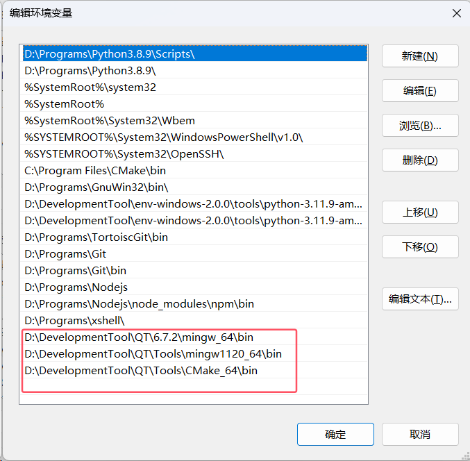

添加QT核心文件按路径、构建工具链路径和CMake工具路径到环境变量。



VSCode中下载必要的插件：C/C++、CMake、QT Configure。

工程根目录下新建一个.vscode文件夹。

在.vscode文件夹中新建tasks.json文件。这个文件主要用于启动CMake和进行编译使用。


```json
{
	"version": "2.0.0", // 配置文件的版本号
	"options": {
		"cwd": "${workspaceFolder}/build/" // 指定任务的工作目录，这里是当前工作区下的build目录
	},
	"tasks": [
		{
			"label": "cmake", // 任务标签，表示该任务的名称
			"type": "shell", // 任务类型，这里是shell任务，表示执行Shell命令
			"command": "cmake", // 执行的命令，这里是调用cmake工具
			"args": [
				".." // 传递给cmake的参数，".."表示上一级目录，这里是指定CMakeLists.txt所在的目录
			]
		},
		{
			"label": "make", // 任务标签，表示编译任务
			"group": {
				"kind": "build", // 任务的类型为构建任务
				"isDefault": true // 设置为默认构建任务，这意味着按F7时会执行该任务
			},
			"command": "mingw32-make.exe", // 使用mingw32-make工具进行构建
			"args": [] // 传递给make命令的参数，这里没有额外的参数
		},
		{
			"label": "C/C++: g++.exe 生成活动文件", // 任务标签，表示调用g++生成活动文件
			"dependsOn": [
				"cmake", // 该任务依赖于cmake任务，必须先执行cmake任务
				"make" // 该任务也依赖于make任务，必须先执行make任务
			]
		}
	]
}
```

在.vscode目录下新建一个launch.json文件。这个文件主要用于启动程序和debug使用。


```json
{
    "version": "0.2.0", // 配置文件的版本号
    "configurations": [
        {
            "name": "SbotIDE Debug", // 调试配置的名称
            "type": "cppdbg", // 调试器类型，cppdbg表示C++调试
            "request": "launch", // 调试请求类型，launch表示启动新程序进行调试
            "program": "${workspaceFolder}/build/SBOTIDE.exe", // 要调试的可执行文件路径，${workspaceFolder}表示当前工作区的路径
            "args": [], // 传递给程序的命令行参数，这里为空数组表示没有参数
            "stopAtEntry": false, // 如果为true，调试器会在程序入口处停止；false表示不会停在入口
            "cwd": "D:/DevelopmentTool/QT/Tools/mingw1120_64/bin", // 调试时的工作目录，设置为MinGW工具链的路径
            "environment": [], // 程序运行时的环境变量，这里没有设置额外的环境变量
            "console": "externalTerminal", // 指定使用外部终端而非内置终端显示程序输出
            "MIMode": "gdb", // 使用的调试器模式，这里是gdb
            "miDebuggerPath": "D:/DevelopmentTool/QT/Tools/mingw1120_64/bin/gdb.exe", // 指定gdb的路径
            "setupCommands": [
                {
                    "description": "为 gdb 启用整齐打印", // 设置命令的描述，用于提示调试器执行什么操作
                    "text": "-enable-pretty-printing", // 启用GDB的整齐打印功能，显示更友好的数据结构信息
                    "ignoreFailures": true // 如果命令执行失败，忽略错误继续调试
                }
            ],
            "preLaunchTask": "C/C++: g++.exe 生成活动文件" // 在启动调试前执行的任务，这里是调用g++生成可执行文件
        }
    ]
}
```

确保Cmake和构建工具链已经正确添加到环境变量中，并且构建脚本和启动脚本中工具链前缀配置正确。

快捷键ctrl+shift+p呼出vscode命令执行框，输入CMake: Select a Kit，选择你使用的构建工具链（刚才已经添加进环境变量，如果没有的话，先输入CMake: Scan for Kits，扫描一下工具链）。


快捷键ctrl+shift+p呼出vscode命令执行框，执行CMake:Configure。


按下F5就可以进行debug。

