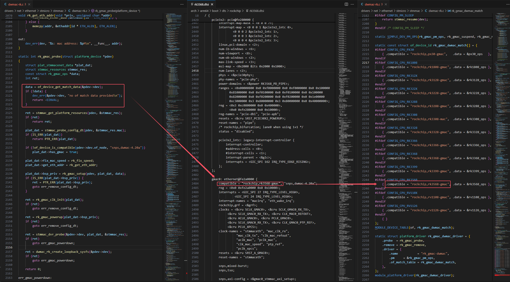
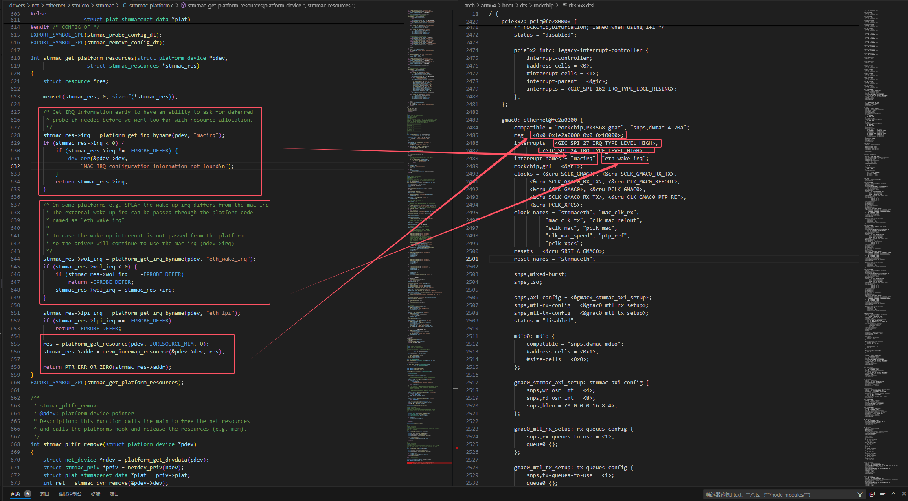

# PHY

PHY芯片通常都符合IEEE标准。IEEE 802.3标准定义了一组标准的MII管理寄存器（如控制寄存器和状态寄存器）。这些标准寄存器通常编号为0到15。

## 标准寄存器列表 (Registers 0–15)

**寄存器 0: 基本控制寄存器（Basic Control Register, BMCR）**

   - 控制PHY的主要操作，例如复位、速度选择、自动协商启用等。

**寄存器 1: 基本状态寄存器（Basic Status Register, BMSR）**

   - 提供PHY的运行状态信息，包括连接状态、能力信息等。

**寄存器 2: PHY标识1（PHY Identifier 1, PHYIDR1）**

   - PHY芯片制造商的标识部分，高16位。

**寄存器 3: PHY标识2（PHY Identifier 2, PHYIDR2）**

   - PHY芯片制造商的标识部分，低16位，包括供应商模型号和版本号。

**寄存器 4: 自动协商广告寄存器（Auto-Negotiation Advertisement, ANAR）**

   - 描述PHY支持的通信能力，如速度和双工模式。

**寄存器 5: 链路伙伴能力寄存器（Link Partner Ability, ANLPAR）**

   - 显示链路对端设备的能力。

**寄存器 6: 自动协商扩展寄存器（Auto-Negotiation Expansion, ANER）**

   - 提供有关自动协商过程的额外信息。

**寄存器 7: 下一个页面传输寄存器（Next Page Transmit, ANNPTR）**

   - 用于支持下一页传输。

**寄存器 8: 链路伙伴下一页寄存器（Link Partner Next Page, ANLPNPR）**

   - 显示链路对端发送的下一页信息。

**寄存器 9: 1000BASE-T能力寄存器（1000BASE-T Control, MSEADR）**

   - 描述PHY对千兆以太网能力的支持。

**寄存器 10: 1000BASE-T状态寄存器（1000BASE-T Status, MSEADR）**

    - 显示千兆以太网的状态信息。

**寄存器 11–15: 保留（Reserved）**

    - 通常为厂商定义的扩展寄存器。

寄存器地址为`0x0`至`0xF`，通过MII（Management Data Input/Output）总线访问。

# DWMAC简介

DWMAC（DesignWare MAC，简称DWMAC）是由Synopsys公司设计的一种网络控制器IP核心，属于DesignWare系列的以太网媒体访问控制器（Ethernet Media Access Controller，MAC）。DWMAC主要应用于嵌入式设备、片上系统（SoC）以及支持以太网通信的设备中。

# DWMAC-RK驱动解析

RK3568的GMAC设备描述在**rk3568.dtsi**文件中可以找到。根据设备树描述可知，RK3568的GMAC控制器使用的是新思科技提供的IP核，型号是**dwmac-4.20a**。

```shell
gmac0: ethernet@fe2a0000 {
    compatible = "rockchip,rk3568-gmac", "snps,dwmac-4.20a";
    reg = <0x0 0xfe2a0000 0x0 0x10000>;
    interrupts = <GIC_SPI 27 IRQ_TYPE_LEVEL_HIGH>,
             <GIC_SPI 24 IRQ_TYPE_LEVEL_HIGH>;
    interrupt-names = "macirq", "eth_wake_irq";
    rockchip,grf = <&grf>;
    clocks = <&cru SCLK_GMAC0>, <&cru SCLK_GMAC0_RX_TX>,
         <&cru SCLK_GMAC0_RX_TX>, <&cru CLK_MAC0_REFOUT>,
         <&cru ACLK_GMAC0>, <&cru PCLK_GMAC0>,
         <&cru SCLK_GMAC0_RX_TX>, <&cru CLK_GMAC0_PTP_REF>,
         <&cru PCLK_XPCS>;
    clock-names = "stmmaceth", "mac_clk_rx",
              "mac_clk_tx", "clk_mac_refout",
              "aclk_mac", "pclk_mac",
              "clk_mac_speed", "ptp_ref",
              "pclk_xpcs";
    resets = <&cru SRST_A_GMAC0>;
    reset-names = "stmmaceth";

    snps,mixed-burst;
    snps,tso;

    snps,axi-config = <&gmac0_stmmac_axi_setup>;
    snps,mtl-rx-config = <&gmac0_mtl_rx_setup>;
    snps,mtl-tx-config = <&gmac0_mtl_tx_setup>;
    status = "disabled";

    mdio0: mdio {
        compatible = "snps,dwmac-mdio";
        #address-cells = <0x1>;
        #size-cells = <0x0>;
    };

    gmac0_stmmac_axi_setup: stmmac-axi-config {
        snps,wr_osr_lmt = <4>;
        snps,rd_osr_lmt = <8>;
        snps,blen = <0 0 0 0 16 8 4>;
    };

    gmac0_mtl_rx_setup: rx-queues-config {
        snps,rx-queues-to-use = <1>;
        queue0 {};
    };

    gmac0_mtl_tx_setup: tx-queues-config {
        snps,tx-queues-to-use = <1>;
        queue0 {};
    };
};
```

驱动代码位于**/kernel/drivers/net/ethernet/stmicro/stmmac/dwmac-rk.c**。

```c
static struct platform_driver rk_gmac_dwmac_driver = {
	.probe  = rk_gmac_probe,
	.remove = rk_gmac_remove,
	.driver = {
		.name           = "rk_gmac-dwmac",
		.pm		= &rk_gmac_pm_ops,
		.of_match_table = rk_gmac_dwmac_match,
	},
};
module_platform_driver(rk_gmac_dwmac_driver);
```

``rk_gmac_probe``函数负责在设备和驱动匹配后初始化 Rockchip 的 GMAC 控制器驱动。

```c
static int rk_gmac_probe(struct platform_device *pdev)
{
	struct plat_stmmacenet_data *plat_dat;
	struct stmmac_resources stmmac_res;
	const struct rk_gmac_ops *data;
	int ret;

	data = of_device_get_match_data(&pdev->dev);
	if (!data) {
		dev_err(&pdev->dev, "no of match data provided\n");
		return -EINVAL;
	}

	ret = stmmac_get_platform_resources(pdev, &stmmac_res);
	if (ret)
		return ret;

	plat_dat = stmmac_probe_config_dt(pdev, &stmmac_res.mac);
	if (IS_ERR(plat_dat))
		return PTR_ERR(plat_dat);

	if (!of_device_is_compatible(pdev->dev.of_node, "snps,dwmac-4.20a"))
		plat_dat->has_gmac = true;

	plat_dat->fix_mac_speed = rk_fix_speed;
	plat_dat->get_eth_addr = rk_get_eth_addr;

	plat_dat->bsp_priv = rk_gmac_setup(pdev, plat_dat, data);
	if (IS_ERR(plat_dat->bsp_priv)) {
		ret = PTR_ERR(plat_dat->bsp_priv);
		goto err_remove_config_dt;
	}

	ret = rk_gmac_clk_init(plat_dat);
	if (ret)
		goto err_remove_config_dt;

	ret = rk_gmac_powerup(plat_dat->bsp_priv);
	if (ret)
		goto err_remove_config_dt;

	ret = stmmac_dvr_probe(&pdev->dev, plat_dat, &stmmac_res);
	if (ret)
		goto err_gmac_powerdown;

	ret = dwmac_rk_create_loopback_sysfs(&pdev->dev);
	if (ret)
		goto err_gmac_powerdown;

	return 0;

err_gmac_powerdown:
	rk_gmac_powerdown(plat_dat->bsp_priv);
err_remove_config_dt:
	stmmac_remove_config_dt(pdev, plat_dat);

	return ret;
}
```

首先使用```of_device_get_match_data``函数用来匹配设备树中启用的GMAC驱动版本，如图：



```stmmac_get_platform_resources```函数用于从设备树中获取GMAC的中断号、唤醒终端号以及低功耗空闲模式中断号。并使用``platform_get_resource```接口获取GMAC控制器的物理内存地址，使用``devm_ioremap_resource``接口映射这段内存地址，以方便接下来的操作。



``stmmac_probe_config_dt``函数有一点复杂。