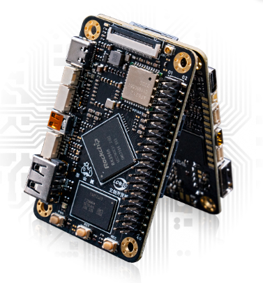


# 前言

前段时间，工作上一直有接触Linux和RTOS的混合部署方案，感觉非常有趣，于是产生了学习和探索这方面技术的兴趣。

为了方便学习，最近一直在寻找一款开发板，用来摸索这方面的技术。各种论坛上搜索了一圈，最终看上了**泰山派**这款开发板。

选择它的理由有很多，主要是因为它是一款非常Open的开发板，嘉立创将这款开发板的原理图、PCB完全开源，立创开源社区在国内也是十分活跃，用户很多，什么实力不用多说。其次这款开发板的主控用的是阉割版的RK3568（RK3566），各项性能和外设资源也都完全满足学习的要求，并且瑞芯微的资料也比较开放和详细。另外RT-Thread官方对RK3568进行了适配（OpenAMP方案），减少了移植RTT的工作。关于Linux，有瑞星微官方和各路开源大神的支持，也不算太慌。所以接下来，只需要专心研究如何同时运行Linux和RT-Thread即可。

文章中若有错误或问题欢迎联系：2423759817@qq.com

# 闲言碎语

这个章节是我用来记录在学习的过程中突发的一些感悟，或者一些奇奇怪怪的想法，所以，如果后来有幸有同学准备读这篇文章的时候，可以忽略掉这一章。

其实在以前从来没有认真的去整理学习一项新的技术或知识的过程，以至于在学习完成后，在想去复盘的时候完全不知道如何开始，学习的过程迷迷糊糊的就结束了。所以打算将接下来的学习一步一步的记录下来，方便自己复盘和反思不足。

其实本来这篇文章我想以时间线的顺序记录每个任务点的，但是想了想，还是算了，主要是自己太菜了（菜就多练），保不齐这次学习需要多久，哈哈哈。

我在想，要不要事无巨细的将学习和开发过程记录下来。假如，我是说假如，将来有人不幸打算来看这篇文章，哪里面参杂太多的废话岂不是让读的人很痛苦哈哈哈。管他的呢，因该没人会来看。

很早之前一直也想像那些大神一样创建一个自己的博客，用来记录或者分享技术。但是由于各种原因，期间也尝试过最终都以失败告终。刚才突然思考了一些失败的原因，核心原因还是自己太懒来了，坚持不下去。

当我尝试写这篇文章或者说尝试通过文字去记录某件事儿的学习过程的时候，文章中的内容顺序和本身学习的顺序其实是有差异的。真正的学习过程中会踩很多的坑，走很多弯路，浪费很多时间。在写文章的时候往往是一个梳理逻辑的过程，所以看起来十分的顺利。但是当我回过头来看这篇文章的时候我就在想，如果我不知道这些东西的情况下按照这些步骤一步一步的进行，太过于顺利反而会让我感觉无趣。哈哈哈，可能这就是探索的意义所在吧。

# 编译Linux

拿到开发板后，第一个任务就是将开发板运行起来。

嘉立创将各种资源和文档进行了整理，全部都放在了 [泰山派文档中心]( https://wiki.lckfb.com/zh-hans/tspi-rk3566/)。

泰山派Linux的编译过程比较简单，因为本身瑞芯微的资料还算成熟，在实际的操作过程中几乎没有遇到什么困难。按照官方文档将SDK下载到Ubuntu18.04中，配置好相关的环境之后，静静等待编译就行了，编译时间比较长。

由于瑞芯微提供的SDK的开发环境是Ubuntu18.04， 而Ubuntu18.04已经停止维护了，所以为了兼容我的其他项目环境，需要将Ubuntu切换成22.04的版本。然而目前的SDK在Ubuntu22.04上存在许多兼容性问题，可能导致编译失败。不过幸运的是嘉立创的文档中有提到如何解决在Ubuntu22.04上编译的一系列问题。一键直达[立创·泰山派RK3566开发 Ubuntu 22.04LTS编译](https://wiki.lckfb.com/zh-hans/tspi-rk3566/documentation/gj-ubuntu-22-04-lts-compile.html)。

因为有些问题其实文档中的解决方式说得不是特别明确，所以这里还是简单的记录下会遇到的一些问题和解决方法。

问题1：

```shell
报错：
	multiple definition of ''fwriter_buffer'';
	multiple definition of ''bwriter_buffer'';
```

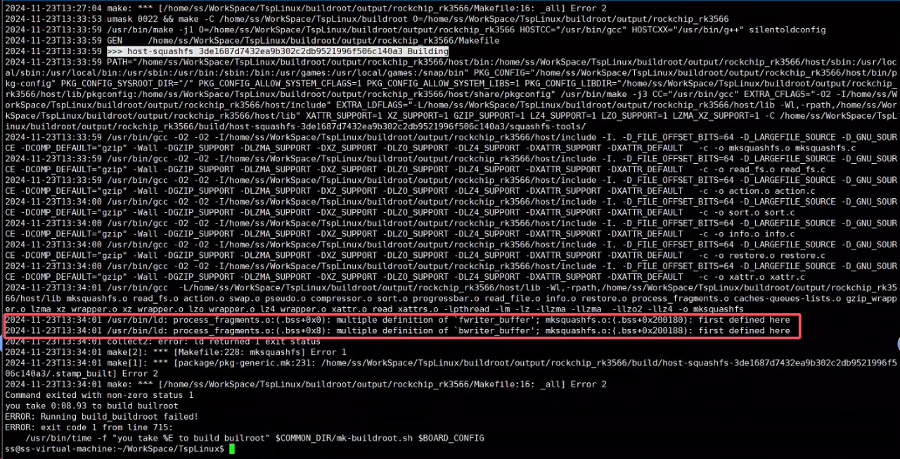

这个问题是由于 ``fwriter_buffer`` 和 ``bwriter_buffer`` 出现了重复定义，解决方式就是修改**mksquashfs.h**文件的136行，加上extern修饰。

使用命令查找**mksquashfs.h**文件路径，可以找到两个文件路径，统统按照下面的方法修改掉就行了。

```she
find -name mksquashfs.h
```


修改136行为：

```C
extern struct cache *bwriter_buffer, *fwriter_buffer;
```

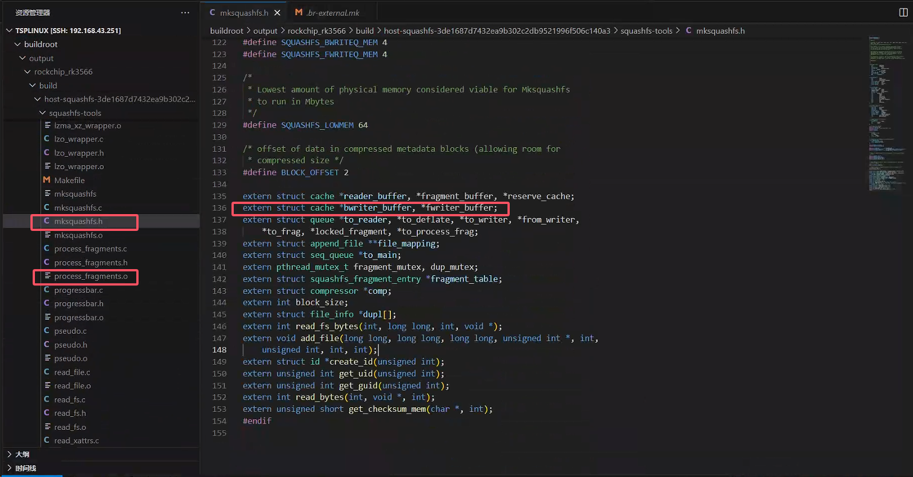

需要注意的是！！！mksquashfs.h所属的文件夹以及里面的文件需要进行一次编译之后才会生成，所以首先需要使用``.\build.sh all``脚本全编译一次之后才能找到这个文件。第一次编译会生成一个这个头文件，修改完成后需要删除同级目录下的**process_fragments.o**文件，否则编译还是依然报错，然后再编译一次会生成第二个头文件，同理按照刚才的方法，再修改一次，就可以正常编译成功了。

因为这个两个文件是使用SDK的构建脚本自动生成，所以如果使用build.py脚本的其他命令导致这两个文件被重新生成了，可能需要再次按照上述方式修改。是否有一步到位的方法，暂时不清楚。

吐槽一下，瑞芯微的SDK真是非常非常的臃肿，超级大。第一编译的时间特别久，需要耐心等待。真是苦了我的老神船了。

# 调整Debug串口波特率

嘉立创提供的SDK中Debug串口默认输出波特率是1500000，有些时候并其实不是特别的方便。有些软件或者串口助手不支持特别高的波特率，在后续的RT-Thread的调试过程中，基本上也都是使用115200波特率来进行调试。所以想试着尝试修改一下Debug串口的波特率。

修改步骤主要参考了网上一些关于RK3568的方法，这是我参考的文章[RK3588修改调试串口的波特率](https://blog.csdn.net/weixin_40768997/article/details/139785257)，其实方法都一样只是把RK3568相关的文件换成RK3566就行了。

RK3566和RK3568的启动分为三个阶段，分别是BootRam阶段，Uboot阶段以及Linux阶段。所以就需要将这几个阶段的Debug串口的波特率全部修改成一致的波特率。否则就会出现一会儿乱码一会儿正常的情况。

## BootRam

1、首先进入``/rkbin/RKBOOT``目录下找到``RK3366MINIALL.ini``文件。

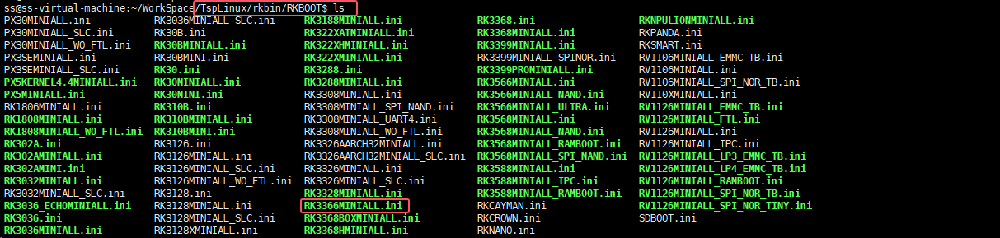

接着使用``cat``命令打印出这个文件内容查看使用的是那个ddrbin文件。

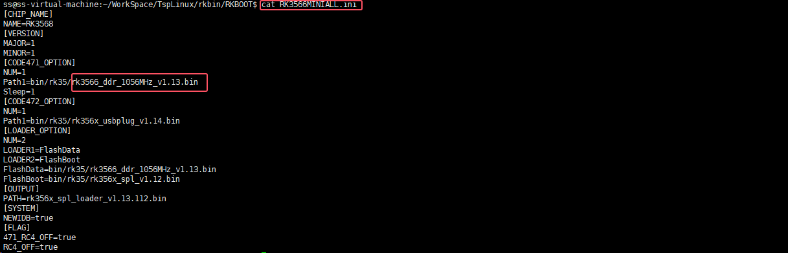

2、使用``find ../ -name rk3566_ddr_1056MHz_v1.13.bin``命令找到**rk3566_ddr_1056MHz_v1.13.bin**文件所在的路径，这个路径后面会用到。


3、修改**rkbin/tools/ddrbin_param.txt**文件中的``uart baudrate``参数。

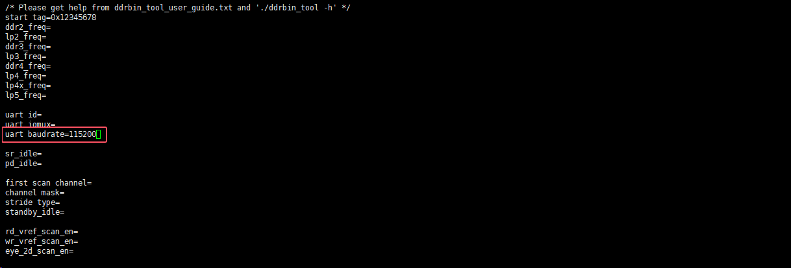

4、执行命令重新生成**rk3566_ddr_1056MHz_v1.13.bin**文件。

```she
./ddrbin_tool ddrbin_param.txt ../bin/rk35/rk3566_ddr_1056MHz_v1.13.bin
```

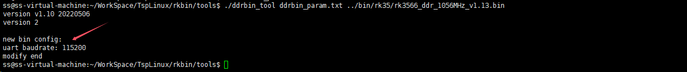

## UBoot

其实经过我的测试，修改完BootRam中的波特率后就可以使用了，不用再修改Uboot中的波特率。虽然Uboot中Debug串口设置的波特率任然是1500000，猜测Uboot中并没有成功初始化串口或者压根就没有初始化，所以使用的配置还是BootRam阶段的波特率。

但是如果依然没有成功，可以按照下面的方式设置一下Uboot中的波特率配置。

1、找到``rk3568_defconfig``文件，在``u-boot\configs`` 目录下 。修改配置项``CONFIG_BAUDRATE``为115200即可。


2、使用``./make.sh rk3566``命令重新配置Uboot。

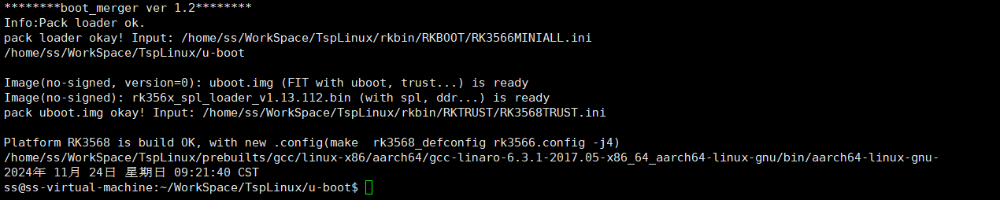

## Linux

Linux下修改一下设备树，将Debug串口的波特率修改成115200即可。

1、进入**kernel/arch/arm64/boot/dts/rockchip/**目录下，找到**tspi-rk3566-core-v10.dtsi**文件。修改``fiq-debugger``节点中的波特率设置。

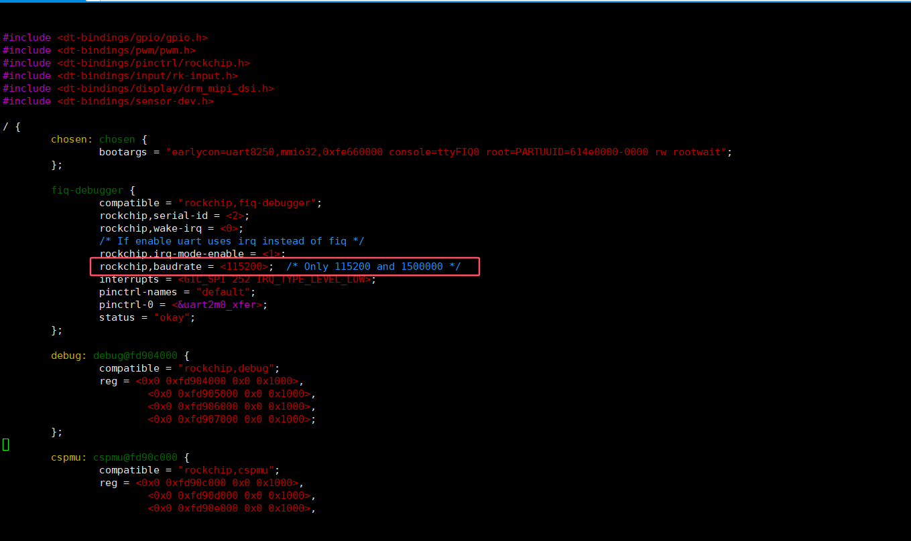

## 完成

完成修改后，重新烧录固件即可。

# 配置TFTP自动下载RTT固件

在后面的RT-Thread的开发中，我们需要经常烧录RT-Thread固件到开发板中运行。烧录的方式有很多，可以使用瑞芯微的下载工具或者直接使用Uboot从TFTP上下载固件引导过去运行。最方便的方式就是使用后者，我们只需要配置好相关的环境和参数后就可以一键下载和引导RT-Thread，为后续的开发提高了效率。

1、嘉立创提供的Uboot修改过，无法在启动的时候进入Uboot，所以这里首先需要设置一下，保证我们能让Uboot暂停下来。

同样找到**rk3568_defconfig**文件，在**u-boot\configs** 目录下 。修改配置项``CONFIG_BOOTDELAY``，可根据自己的需要修改，我这里设置的是等待1s。

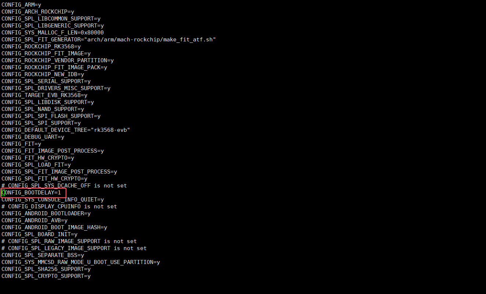

2、默认的Uboot没有打开以太网驱动，因为后面需要使用网口与电脑的TFTP服务器通信，所以还需要将网口驱动打开。

将泰山派的[网口扩展板补丁（密码：qcxx）](https://pan.baidu.com/s/1HtnpytCBBqBOqZi8mfV4VQ?pwd=qcxx#list/path=%2F%E7%AB%8B%E5%88%9B%C2%B7%E6%B3%B0%E5%B1%B1%E6%B4%BE%E5%BC%80%E5%8F%91%E6%9D%BF%E8%B5%84%E6%96%99%2F%E7%AC%AC09%E7%AB%A0.%E3%80%90%E7%AB%8B%E5%88%9B%C2%B7%E6%B3%B0%E5%B1%B1%E6%B4%BE%E3%80%91%E9%A1%B9%E7%9B%AE%E6%A1%88%E4%BE%8B%2F%E3%80%90%E5%BA%95%E9%83%A8%E6%89%A9%E5%B1%95%E6%9D%BF%E3%80%91%E9%A1%B9%E7%9B%AE%E8%B5%84%E6%96%99%2F%E3%80%90%E5%BA%95%E9%83%A839%E8%84%9A%E3%80%914G_HUB2.0_ET100_HS%E6%89%A9%E5%B1%95%E6%9D%BF%2FLinux%E5%9B%BA%E4%BB%B6%2F%E8%A1%A5%E4%B8%8120240620)下载放到SDK的**Kernel**目录下，然后执行：

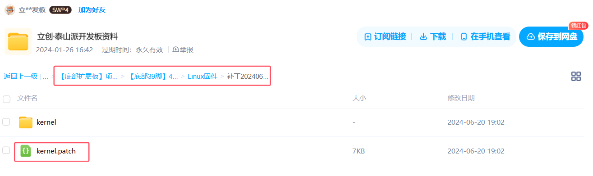

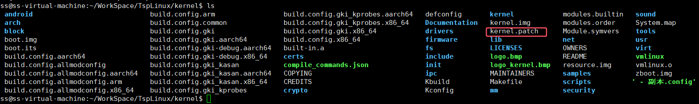

```shell
patch -p1 < kernel.patch
```

接着将Linux中**Gamc1**的设备树配置添加到Uboot中。

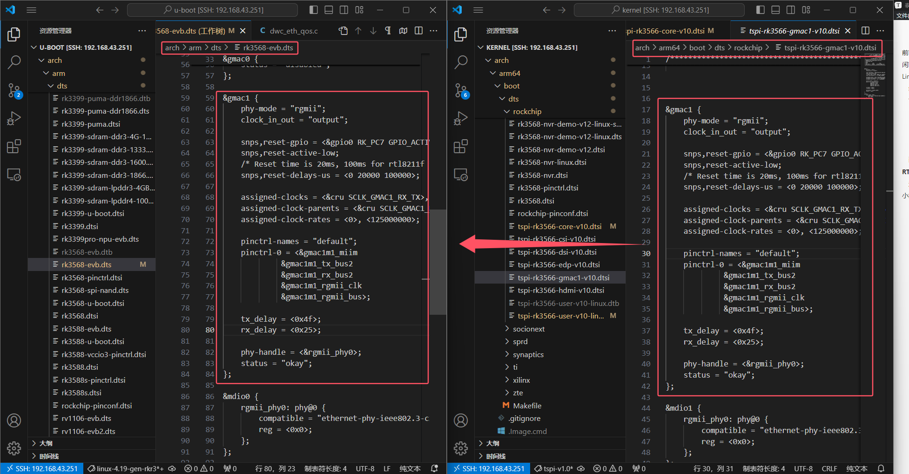

3、启用环境变量的保存至emmc中，防止反复添加环境变量。

进入SDK的Uboot目录下输入命令：

```shell
make menuconfig
```


找到**Enviroment -> Select the location of the enviroment -> Environment in an MMC device**。

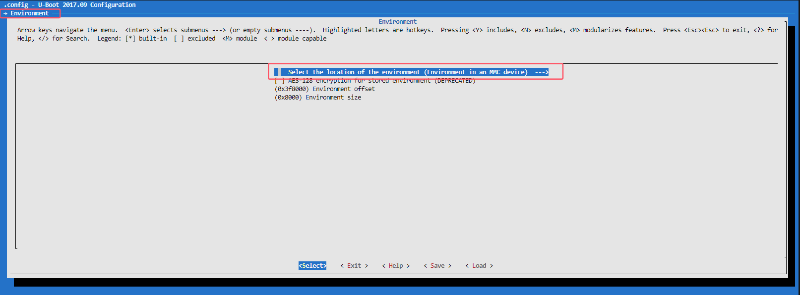

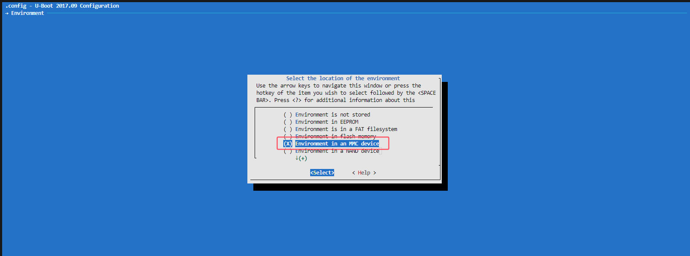

双击Esc按键退出menuconfig并保存配置。

4、全编译SDK（不要单独升级Uboot），生成**update.img**，烧录进开发板。

5、配置Uboot环境变量。

在控制台中一直按住**CTRL + C**，然后复位开发板，进入Uboot。

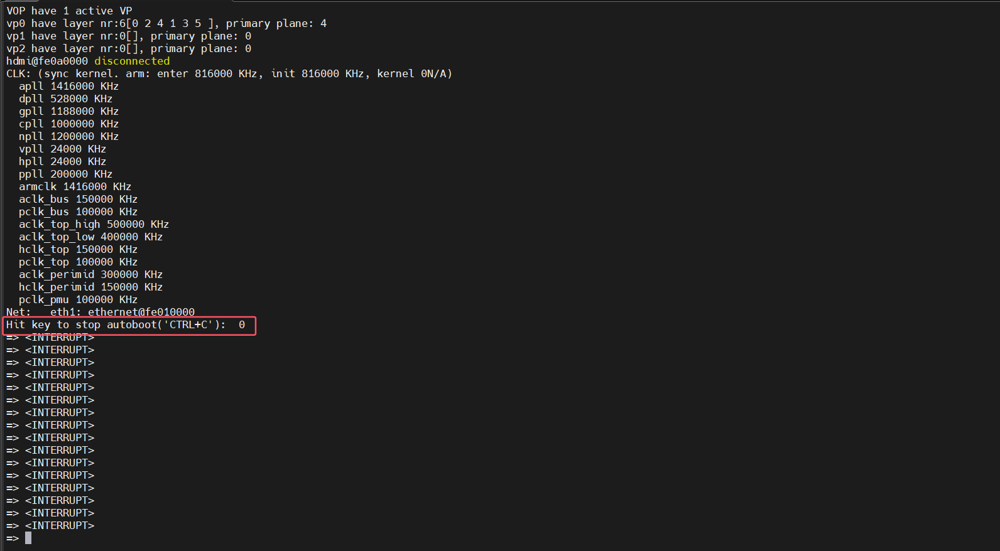

设置Uboot的IP地址，以及TFTP服务器的地址。

```shell
# 设置IP地址
setenv ipaddr 192.168.1.2
# 设置服务器地址
setenv serverip 192.168.1.3
```


设置自动引导命令。

```shell
setenv bootcmd 'tftp 0x280000 rtthread.bin; go 0x280000'
```


保存环境变量到emmc中。

```shell
saveenv
```

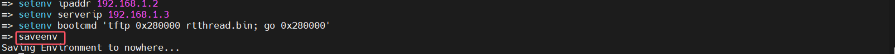

上面的这些配置是根据我的开发环境来设置的，比如我的开发板是用网线连接到我的电脑上，因此TFTP服务器在我的电脑上，我的电脑上网口的IP是192.168.1.3，所以这里**serverip**设置的就是我的电脑的网口IP地址，为了保证板子和电脑在同一个网段，所以**ipaddr**设置的是192.168.1.2。后续调试RT-Thread的时候我一般是将固件下载到0x280000这个地址然后从这里启动，所以这里**bootcmd**设置的地址是0x280000，包括后面的**go**命令跟的地址也是0x280000。

6、接下来就可以将TFTP服务器启动，然后摁一下板子的复位键一键下载并启动RT-Thread了。

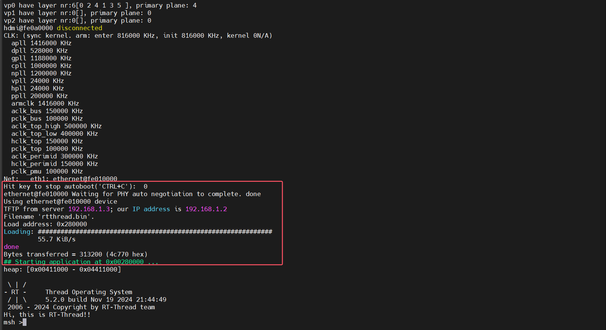

# 运行RT-Thread

Linux顺利运行后，接下来就要开始着手尝试运行RT-Thread了。

浏览了一下[RT-Thread的官方仓库](https://gitee.com/rtthread/rt-thread/tree/master/bsp/rockchip)，发现RTT官方适配过RK3568。RK3566和RK3568类似，所以接下来就是尝试一下能不能直接将RTT在这个板子上跑起来。

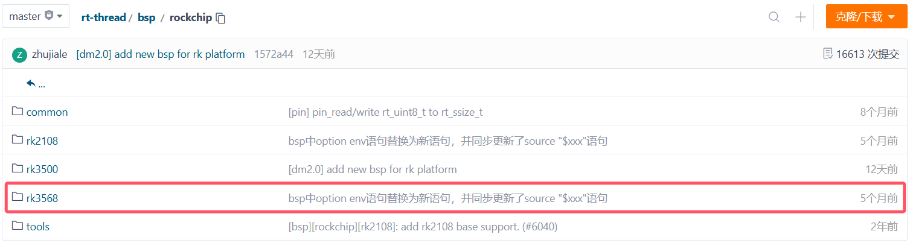

进入RK3568的BSP文件目录下，右键在此打开RTT ENV工具，输入`scons -j16`，尝试编译一下。需要注意的是，RT-Thread5.0新版的对老版本的ENV支持得不是很好，所以为了避免麻烦，将ENV升级到了2.0。

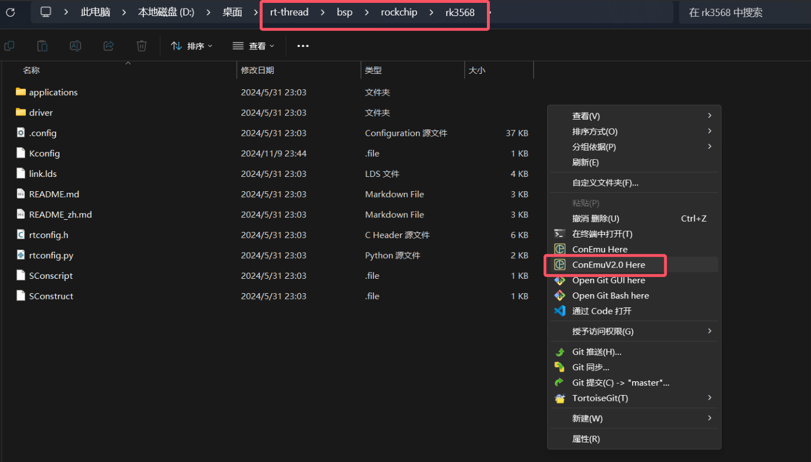

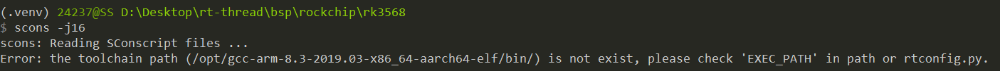

不出意外的话是出意外了，编译不了，提示找不到工具链。不过不用慌，只需要将ARM官网上下载一个工具链即可。ENV中提示的是找不到*gcc-arm-8.3-2019.03-x86_64-aarch64-elf*这个版本的工具链，直接下载这个版本的就行。传送门[gcc-arm-8.3-2019.03-i686-mingw32-aarch64-elf.tar.xz](https://developer.arm.com/-/media/Files/downloads/gnu-a/8.3-2019.03/binrel/gcc-arm-8.3-2019.03-i686-mingw32-aarch64-elf.tar.xz?revision=1c8636ec-0cca-455b-be17-726f1b396f46&rev=1c8636ec0cca455bbe17726f1b396f46&hash=0107DE39C8803E7C762E2FB079BF3822AA6B6AE2)。

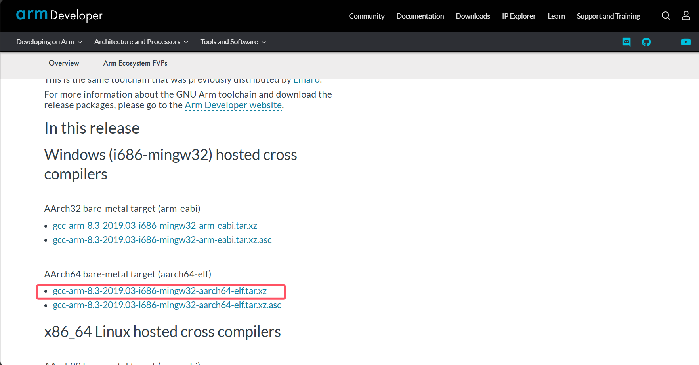

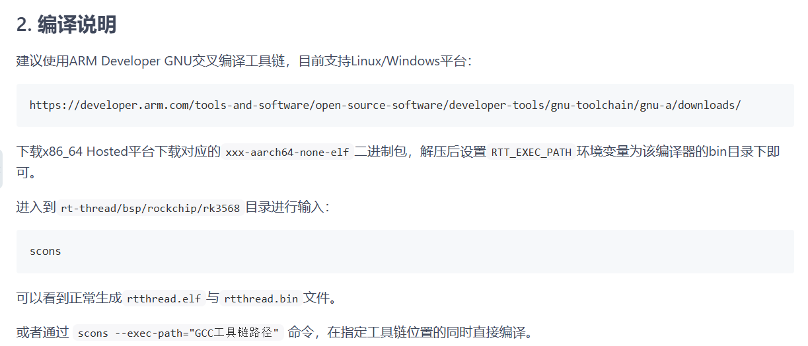

工具链下载完成后按照BSP中的READ_ME的提示配置好环境变量然后再次编译，编译成功，使用`scons --dist`命令打包工程即可，打包的工程存放在BSP目录下的dist文件夹下，后续可以将工程复制到任何路径下进行开发了。

前面已经搭建好了自动下载的环境，接下来只需要将TFTP服务器启动起来，将RTT固件放在TFTP服务器目录下，每次重启后，都可以Uboot会自动执行命令``tftp 0x280000 rtthread.bin; go 0x280000``，从TFTP服务器上拉去RTT固件到DDR中，然后启动起来。

有了前两步的铺垫，接下来就可以正式进入AMP方面的学习与研究了。

# 关闭IO电源域配警告打印

启动Linux后，shell会定时打印**IO电源域警告**，非常的烦人，暂时不太清楚这个警告的作用和意义。后面有时间了再去详细研究一下RK3566的电源域配置。

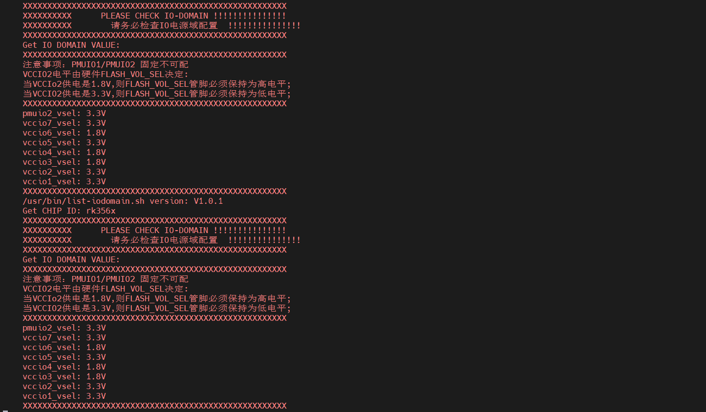

注释掉****这个脚本的最后三行可以关闭这个打印。

```shell
if [ "$1" = "-h" -o "$1" = "--help" ]; then
        help_msg
fi
#chk_env
#get_chip_id $1
#echo_msg "Get CHIP ID: $CHIP_ID"
#get_iodomain_val
```

# Wifi配置

直接使用wifi_start.sh脚本连接wifi就行。

```shell
wifi_start.sh wifi名字 wifi密码
```

# 搭建NFS共享文件夹

因为后面开发需要经常向开发板发送固件，最高效的方法是在开发板和开发的虚拟机之间搭建一个共享文件夹。这样可以大大提高效率。

关于如何搭建NFS，我参考了一下几篇文章：

[快速配置NFS服务实现Linux主机与ARM开发板文件共享](https://blog.csdn.net/u010000843/article/details/115300528)

需要注意的是，泰山派的BuildRoot没有启用nfs，文件系统中没有nfs工具所需要的动态库（/sbin/mount.nfs、/sbin/mount.nfs4、/usr/lib/libtirpc.so.*），挂载时会失败。因此我们需要去sdk中启用nfs工具。

1、配置BuildRoot，启用NFS

进入sdk根目录下的**buildroot**目录下，输入``make menuconfig``命令打开menuconfig，进入**arget packages → Filesystem and flash utilities**路径下，打开**nfs-utils**选项。

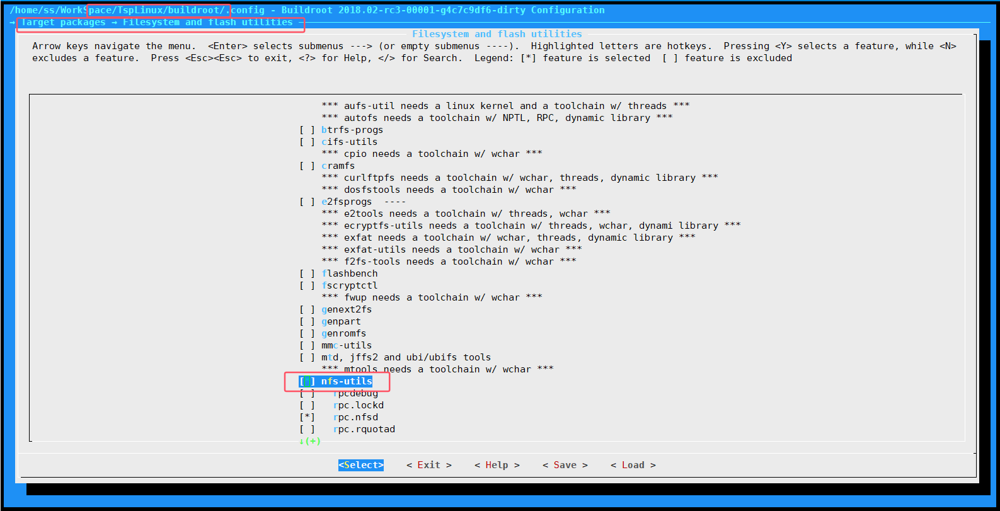

退出menuconfig，输入Y保存配置即可。

注意！！！！！比较奇葩的一点是，在sdk根目录下，再次输入``./build.sh buildroot``单独编译buildroot后，nfs依然没有被编译进去。原因在于，编译脚本编译buildroot时，使用的并不是我们刚才通过menuconfig配置后生成的.config文件，而使用的是**./buildroot/configs/rockchip_rk3566_defconfig**配置文件，就和linux kernel一样，所以这点还是有点坑的。因为懒得修改sdk的编译脚本，我们直接将nfs的宏加入到这个文件就行了。

另外，启用了nfs工具后，编译可能报错，解决方法参考**rpcbind报错**小节。

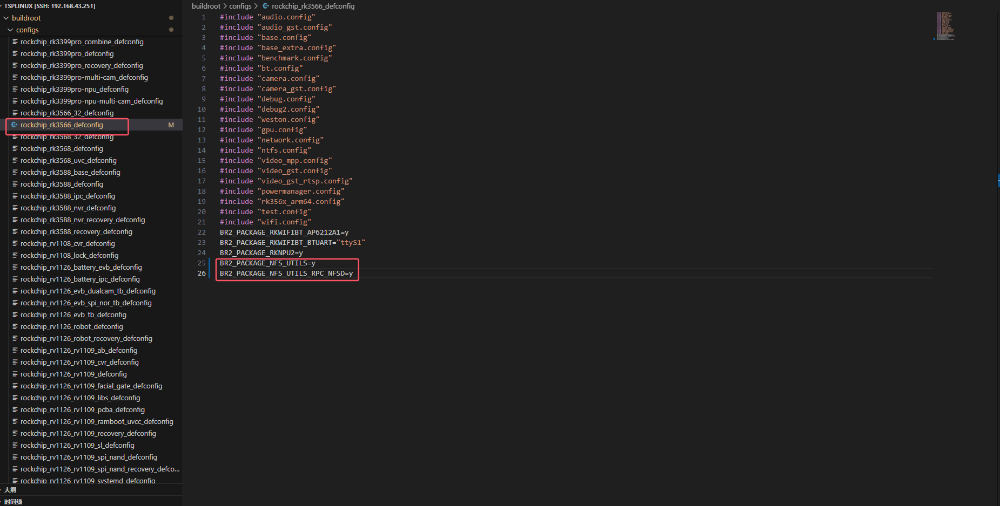

最后，在sdk根目录下再次输入``./build.sh buildroot``单独编译buildroot，然后将**./rockdev/rootfs.img**烧录到roofs分区即可。

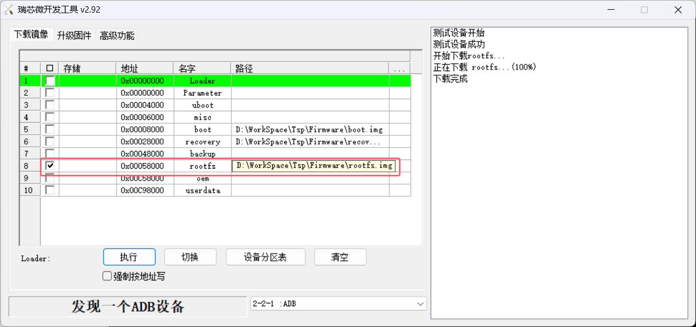

2、启用nfs

接下来就可以按照之前给出的链接中的教程，搭建虚拟机与开发板之间的共享文件夹了。需要特别注意的是网络问题，再次不多做赘述。

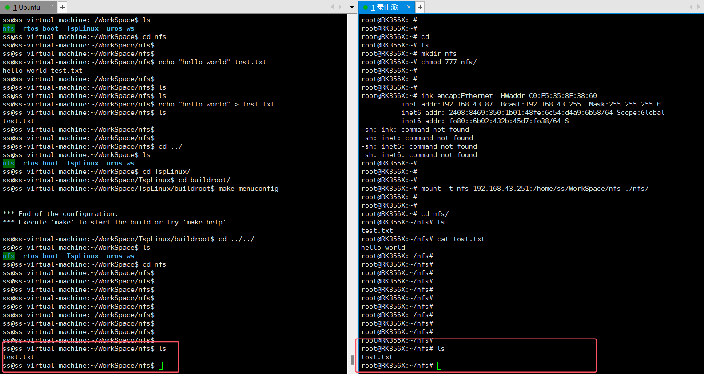

```shell
mount -t nfs 192.168.43.251:/home/ss/WorkSpace/nfs ./nfs/
```

# PSCI

PSCI全称Power State Coordination Interface，**电源状态协调接口**，是 ARM 架构的一部分，它定义了一组标准的接口和协议，用于协调处理器和系统的**电源管理**。PSCI 的目标是使操作系统能够与硬件平台进行交互，以便有效地管理系统的功耗和能源效率，尤其是在多核处理器和复杂的硬件架构中。

PSCI的主要功能：

1. 处理器电源管理：PSCI 允许操作系统或固件通过标准接口管理处理器的电源状态。这包括将处理器置于不同的低功耗状态（如休眠状态）或将其完全关闭。
2. 统一的接口：PSCI 提供了一组标准的接口，使得操作系统、固件和硬件之间能够以统一的方式协调电源管理，而不依赖于特定平台的实现。它使操作系统可以独立于硬件平台进行电源管理。
3. 支持多核系统：在多核系统中，PSCI 提供了一种协调机制，使得操作系统可以管理每个核心的电源状态。例如，操作系统可以将某些核心置于低功耗状态或关闭某些核心，以降低能耗。

PSCI 定义了一些关键的接口函数，这些函数由固件或操作系统调用，用于控制电源状态和协调处理器的电源管理。以下是一些常见的 PSCI 接口：


1. CPU_ON：用于开启一个处理器核。
2. CPU_OFF：用于关闭一个处理器核。
3. CPU_SUSPEND：将处理器置于低功耗的挂起状态。
4. CPU_DIE：使处理器核完全关闭。
5. AFFINITY_INFO：获取处理器或其他硬件组件的电源状态信息。

版本：
PSCI 在不同版本中有不同的功能，常见的版本包括：

PSCI 0.1：基本的电源管理接口。
PSCI 0.2：添加了更多高级功能，例如支持多级电源管理和处理器电源状态查询。
受信任的操作系统（TOS）和 PSCI：
在一些系统中，PSCI 可能会受到受信任的操作系统（TOS）的限制。例如，TOS 可能会要求某些电源管理操作只能由它来执行，防止操作系统外部的其他软件改变电源状态。

# AMP启动流程

如何在运行Linux的同时运行RTOS，常规的做法是将固件放置到Linux的文件系统中，然后将固件拷贝到指定的DDR区域，最后使用PSCI接口控制指定CPU从该DDR区域开始运行。

# FAQ

## rpcbind报错

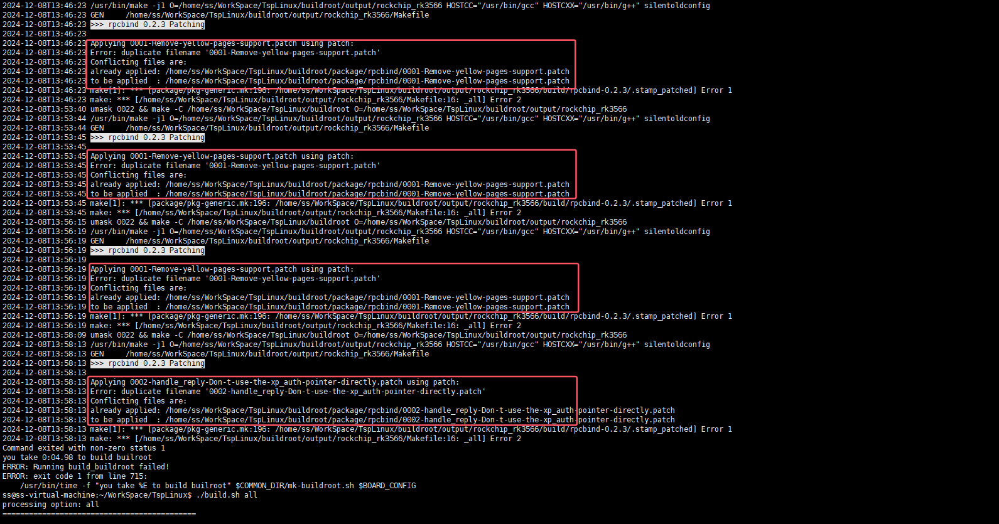

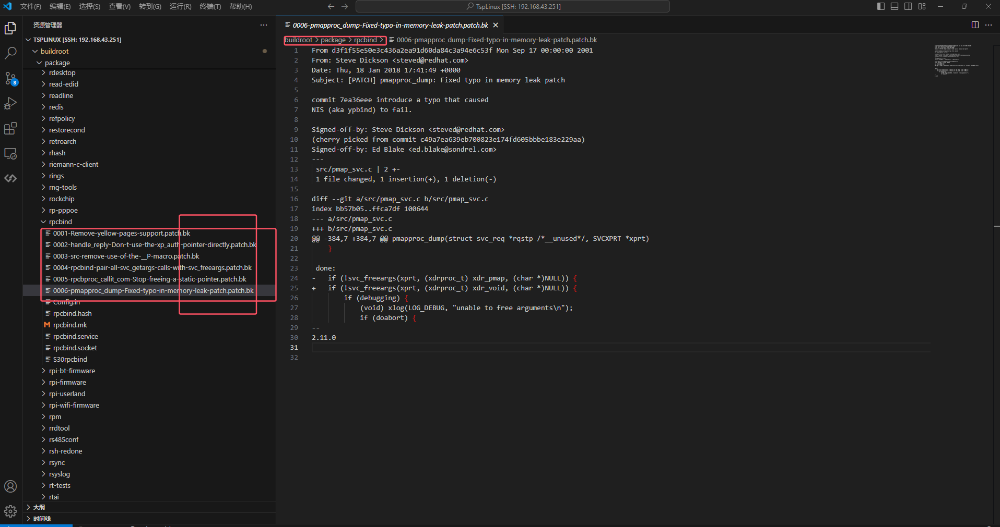

启用了nfs工具后，rpcbind也会被启用，后续的编译过程中可能会出现如上报错。原因可能是因为编译脚本存在问题，导致rpcbind工具重复打补丁引起的，具体原因不太了解，暂时也不用去深入研究。我的解决方法是将**./buildroot/package/rpcbind/**目录下的所有**patch**文件删除掉，这样就不会再次补丁。

# Tips

## 查找DDR可用区域

查找Linux中可用的区域，使用``cat /proc/iomem``命令查看系统内存的详细信息。其中**System RAM**是linux系统和应用程序的主要内存资源，操作系统确保只有那些被明确标记为“可用”的区域才会用于程序运行。所以我们可以在这些区域预留空间，但是要注意避开已经被被分配了的内存区域。

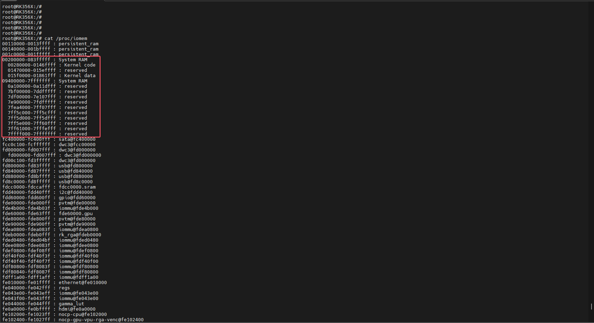

## 设备树节点

linux中一切皆文件，设备树节点也不例外。设备树节点通常保存在**/proc/device-tree/**目录下。

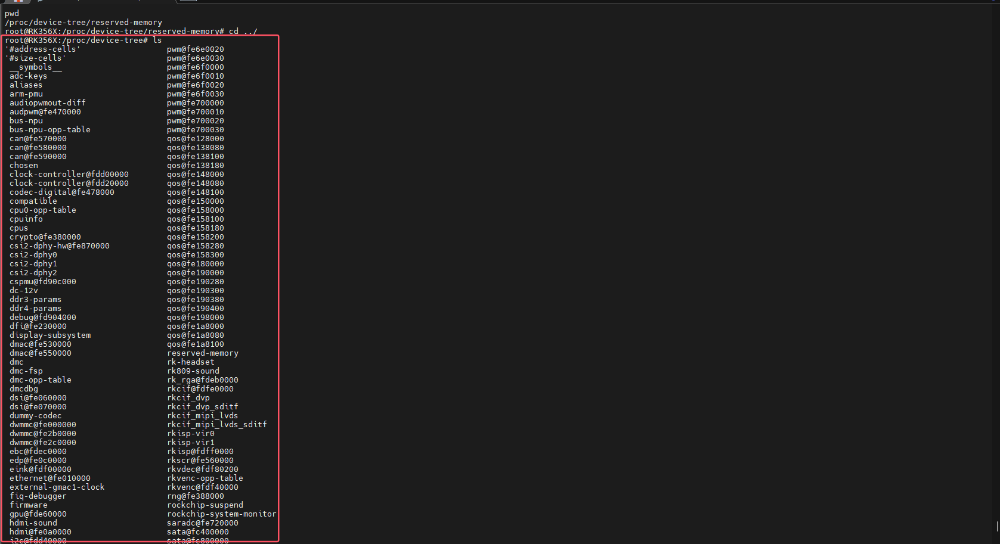

# 总结
